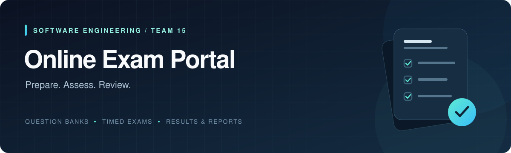
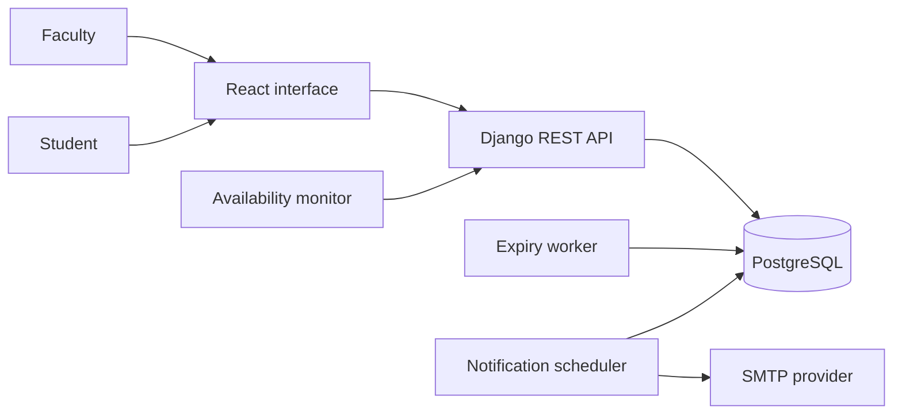

<div align="center">



<br />

**From question banks to results. One place for the entire exam workflow.**

A React + Django application for faculty and students, with timed assessments,<br />
durable answer recovery, automatic evaluation and clear reporting.

[](https://github.com/chiranthanv/online-exam-portal/actions/workflows/backend.yml)
[](https://github.com/chiranthanv/online-exam-portal/actions/workflows/frontend.yml)


**[Watch the demo](docs/DEMO.md)** &nbsp; / &nbsp;
**[Get started](#getting-started)** &nbsp; / &nbsp;
**[Explore the docs](#documentation)** &nbsp; / &nbsp;
**[View the release](https://github.com/chiranthanv/online-exam-portal/tree/sprint2-final-2026-11-10)**

</div>

---

## Built around the exam

Faculty prepare questions, organize batches and schedule assessments. Students see
their eligible exams, answer within server-controlled deadlines and review results
after release. The application keeps administrative and student access separate,
excludes answer keys from student attempt payloads and locks responses when an
attempt closes.

| Prepare | Assess | Review |
| :--- | :--- | :--- |
| Create and filter MCQs | Run timed, session-bound attempts | Evaluate answers on the server |
| Import student rosters | Autosave and recover local answers | Release results on schedule |
| Assign exams to batches | Submit manually or at expiry | Export class and question reports |

## A look inside


<p align="center"><sub>Faculty question-bank workspace · Captured from the application demonstration</sub></p>

<details>
<summary><strong>Open the student workspace preview</strong></summary>


These screenshots come from the preserved Sprint 1 recording. The
[Sprint 2 walkthrough](docs/DEMO.md) shows the integrated product, GitHub and Jira.

</details>

## Features

| Capability | What the portal provides |
| :--- | :--- |
| **Accounts & access** | Administrator/student roles, JWT authentication, failed-login lockout, session recovery and single-use password reset |
| **Question banks** | Marks and penalties, subject/topic/difficulty filters, input validation and protection for questions already used in exams |
| **Students & batches** | CSV/XLSX roster import, row-level error reporting and batch membership management |
| **Exam scheduling** | Manual or random question selection, calculated total marks and batch-based eligibility |
| **Answer recovery** | Autosave, scoped durable offline recovery and bounded save retries |
| **Timing & submission** | One attempt per student/exam, HttpOnly session binding, server deadlines, expiry processing and immutable closed responses |
| **Evaluation & reports** | Server-side marking, negative penalties, release-gated results, class/question reports and authenticated CSV/PDF exports |
| **Exam oversight** | Focus-event observations, reason-required disqualify/re-permit actions and audit records |
| **Email notifications** | Durable schedule/result outboxes, deduplication, retries, a background scheduler and SMTP support |
| **Operations** | Database health endpoint, external availability monitoring, a disposable load benchmark and query-plan inspection |

## Getting started

### Run with Docker

Requires Git and Docker with the Compose plugin. The image builds the React
interface and serves it with Django; PostgreSQL and background workers run as
separate services.

```bash
git clone https://github.com/chiranthanv/online-exam-portal.git
cd online-exam-portal
cp .env.example .env
```

Set a local database password in `.env` before starting. URL-encode any URL-special
characters because the password is used in `DATABASE_URL`. On PowerShell, use
`Copy-Item .env.example .env` in place of `cp`.

```bash
docker compose up -d db
docker compose run --rm api python manage.py migrate --noinput
docker compose run --rm api python manage.py seed_demo
docker compose up -d api worker scheduler
```

**Open [localhost:8000](http://localhost:8000)** to use the local demo.

<details>
<summary><strong>Prefer running without Docker?</strong></summary>

Use Python **3.11 or 3.12** and Node.js **24**. From the repository root:

```bash
python -m venv .venv
source .venv/bin/activate
python -m pip install -r requirements-dev.txt
python backend/manage.py migrate
python backend/manage.py seed_demo
python backend/manage.py runserver 127.0.0.1:8000
```

On Windows, activate with `.\.venv\Scripts\Activate.ps1` instead of the `source`
command. In a second terminal:

```bash
cd frontend
npm ci
npm run dev
```

Open **[localhost:5173](http://localhost:5173)**. Vite proxies API calls to Django on
port 8000. Keep `localhost` consistent between the interface and API for cookies.

For automatic submission while browsers are closed, run in another activated
Python terminal:

```bash
python backend/manage.py expire_exam_attempts --loop --interval 1
```

For schedule/result notification processing, use a separate activated terminal:

```bash
python backend/manage.py run_notification_scheduler --interval 60
```

Local development defaults to SQLite and file-based email. Django does not
automatically load `.env` outside Docker Compose; export environment variables
explicitly when needed. See the [development guide](docs/DEVELOPMENT.md) for the
full configuration.

</details>

### Demo accounts

The seed command creates 50 MCQs, three batches, an available practice exam and
these synthetic accounts:

| Sign-in email | Role |
| :--- | :--- |
| `demo-admin@example.test` | Faculty administrator |
| `demo-student@example.test` | Student assigned to the practice exam |
| `demo-other@example.test` | Student in a different batch |

Default demo password: **`Local-Demo-Only-827!`**. Set `DEMO_PASSWORD` before seeding
to choose another password for newly created accounts. Rerunning the seed command
preserves existing passwords. Use these fixtures only for local development.

## Architecture



| Layer | Stack |
| :--- | :--- |
| **Interface** | React 19, Vite, responsive CSS |
| **API** | Django 5.2, Django REST Framework, JWT authentication |
| **Data** | PostgreSQL 16; SQLite for local development |
| **Runtime** | Python 3.11, Gunicorn, WhiteNoise, Docker Compose |
| **HTTPS** | Optional Caddy reverse-proxy profile |
| **Verification** | Django tests, PostgreSQL concurrency checks, Vitest, Playwright and GitHub Actions |

The container serves the compiled interface and API from one origin. Answers are
stored in the database; the expiry worker applies server deadlines even when a
student disconnects. The notification scheduler processes durable outboxes.

<details>
<summary><strong>Repository map</strong></summary>

```text
backend/       API, models, migrations, configuration and workers
frontend/      React interface, unit tests and browser scenarios
deploy/        Reverse-proxy configuration
scripts/       Monitoring, load measurements, TLS checks and SMTP launcher
docs/          Guides, design decisions, test reports and demonstrations
UML diagrams/  Submitted design diagrams
.github/       Automated verification workflows
```

</details>

## Verification & release

The frozen **[Sprint 2 release](docs/releases/SPRINT2_FINAL_2026-11-10.md)** includes
the final test reports and records the measured scope of each check.

| Release-baseline check | Recorded result |
| :--- | :--- |
| PostgreSQL backend suite | **101 tests passed** |
| Availability monitor regressions | **9 tests passed** |
| Frontend unit/component suite | **16 tests passed** |
| Chromium browser scenarios | **12 scenarios passed** |
| Backend statement coverage | **96.07%** · 1,099 / 1,144 statements |
| Backend branch coverage | **84.52%** · 213 / 252 branches |

These figures belong to the recorded release baseline. Execution evidence,
denominators and environment limits are in the
[testing deliverables](docs/testing/part3/README.md). Operational measurements
retain their own revision and environment; they do not certify a production SLA
or blanket accessibility conformance.

**Email follow-up:** real Gmail SMTP delivery and receipt from the portal's
password-reset flow were confirmed after the freeze. The
[SMTP verification record](docs/testing/smtp/RESULT_2026-11-10.md) includes the
session-only launcher and its measured scope. Local development still defaults
to file-based email until SMTP is configured.

<details>
<summary><strong>Run the development checks</strong></summary>

With the Python environment activated, from the repository root:

```bash
python -m ruff check .
python -m ruff format --check .
python backend/manage.py check
python backend/manage.py makemigrations --check --dry-run
python -m coverage run backend/manage.py test portal.tests --verbosity 2
python -m coverage report
python -m unittest discover -s scripts -p 'test_monitor*.py' -v
```

Frontend checks:

```bash
cd frontend
npm run lint
npm test
npm run build
```

PostgreSQL is required for concurrency/row-lock verification. Browser setup,
disposable data requirements and Windows launcher notes are in the
[development guide](docs/DEVELOPMENT.md#frontend-and-integrated-browser-checks).

</details>

## Documentation

| Start here | What you will find |
| :--- | :--- |
| [Product demonstrations](docs/DEMO.md) | Two-minute overview, extended Sprint 2 video and preserved Sprint 1 walkthrough |
| [Development & deployment](docs/DEVELOPMENT.md) | Setup, environment variables, workers, HTTPS and troubleshooting |
| [API reference](docs/API.md) | Authentication, administrative routes and student attempt contract |
| [Design decisions](docs/DEVIATIONS.md) | Implementation choices and changes from the submitted baselines |
| [Requirements traceability](docs/testing/RTM.md) | SRS requirements mapped to implementation and evidence |
| [Test cases & final reports](docs/testing/part3/README.md) | Updated test cases, unit/system reports and combined coverage PDF |
| [Performance](docs/testing/performance/README.md) | Reproduction commands and recorded benchmark scope |
| [Availability](docs/testing/availability/README.md) | Exam-window measurement prerequisites and evidence |
| [Final release notes](docs/releases/SPRINT2_FINAL_2026-11-10.md) | Frozen baseline, acceptance record and release integrity |
| [Complete documentation index](docs/DOCUMENTATION.md) | All guides and supporting evidence |

For deployment, use PostgreSQL, a strong private secret key, HTTPS origins, SMTP
and the background workers. The [deployment guide](docs/DEVELOPMENT.md#deployment-configuration)
covers migrations, faculty-account creation and the optional Caddy profile. Use a
fresh database and private credentials instead of the demo fixtures.

---

## The team

**Team 15** · Software Engineering Mini-Project

| Member | SRN | GitHub |
| :--- | :--- | :--- |
| Chiranthan V | PES2UG24CS138 | [@chiranthanv](https://github.com/chiranthanv) |
| Dwijesh Krishna Ghattamaraju | PES2UG24CS163 | [@Dwijesh60](https://github.com/Dwijesh60) |
| Harkirat Singh | PES2UG24CS180 | [@h4ki06](https://github.com/h4ki06) |

<div align="center">

<br />

**Prepare with clarity. Assess with confidence. Review with evidence.**

[Project board](https://github.com/users/chiranthanv/projects/1) &nbsp; / &nbsp;
[Issues](https://github.com/chiranthanv/online-exam-portal/issues) &nbsp; / &nbsp;
[Pull requests](https://github.com/chiranthanv/online-exam-portal/pulls) &nbsp; / &nbsp;
[Back to top](#readme)

</div>
