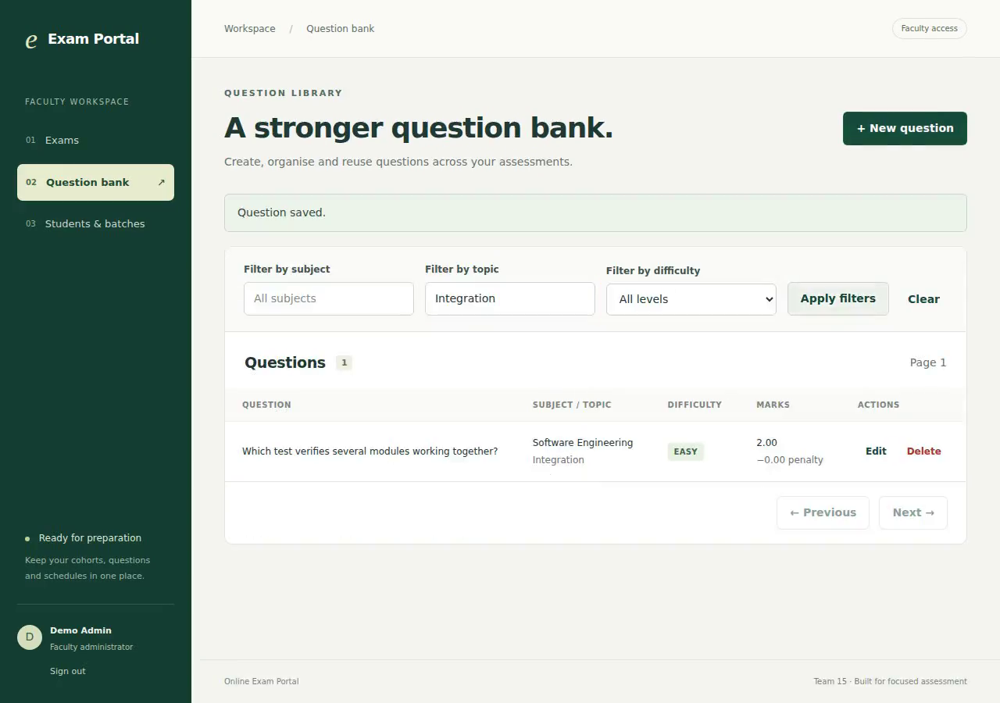
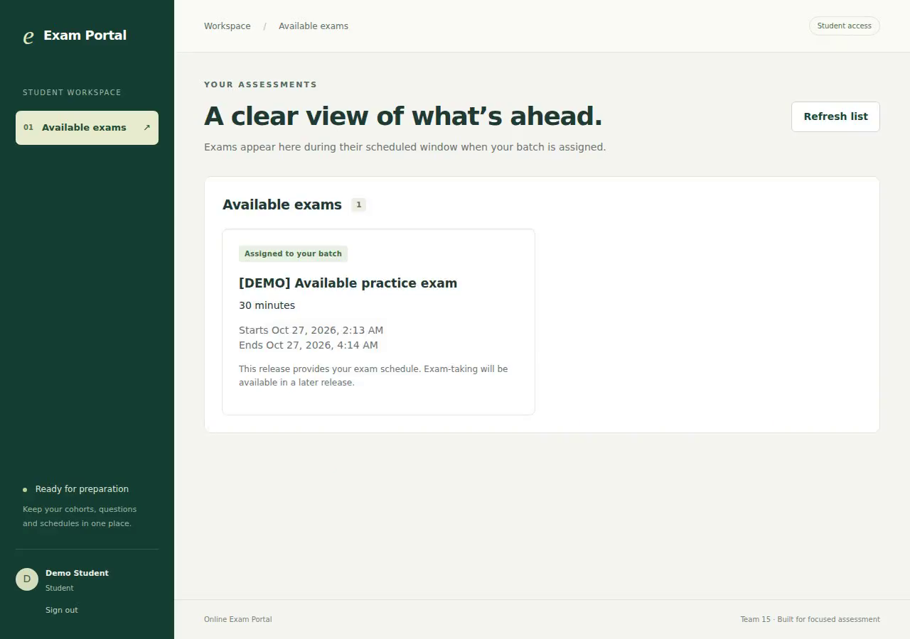
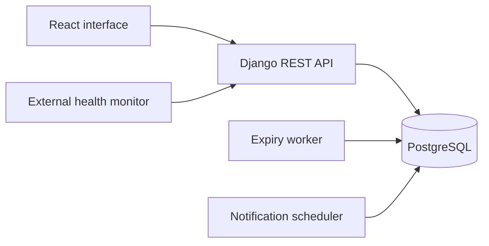

<div align="center">

# Online Exam Portal

**A focused workspace for preparing exams and delivering timed online assessments.**

Built with React, Django REST Framework and PostgreSQL.

[](https://github.com/chiranthanv/online-exam-portal/actions/workflows/backend.yml)
[](https://github.com/chiranthanv/online-exam-portal/actions/workflows/frontend.yml)
[](https://react.dev/)
[](https://www.djangoproject.com/)
[](https://www.postgresql.org/)

[Getting started](#getting-started) · [Features](#features) · [Documentation](#documentation) · [Demo](docs/DEMO.md)

</div>

---

## Overview

Online Exam Portal brings exam preparation and student participation into one application. Faculty can organize question banks, manage students and batches, configure exam schedules and assign assessments. Students access their eligible exams through a session-bound interface with saved answers and server-controlled deadlines.

The project separates administrative and student access, keeps answer keys out of student attempt payloads, and protects responses once an attempt is closed.

## Interface preview



*The faculty workspace, captured from the recorded application demonstration.*

<details>
<summary>View the student workspace</summary>



See the [recorded walkthrough](docs/DEMO.md) for the demonstration's source revision and environment.

</details>

## Features

| Area | Capabilities |
| --- | --- |
| **Accounts & access** | Administrator/student roles, JWT authentication, failed-login lockout, session recovery and single-use password reset |
| **Question bank** | MCQs with marks and penalties, subject/topic/difficulty filters, validation and protection for questions already used in exams |
| **Students & batches** | CSV/XLSX roster import, row-level error reporting and batch membership management |
| **Exam preparation** | Schedules, manual or random question selection, calculated total marks and batch-based eligibility |
| **Exam attempts** | One attempt per student/exam, session binding, answer autosave, refresh recovery and bounded save retries |
| **Timing & submission** | Server-calculated deadlines, manual submission, background expiry processing and immutable closed responses |
| **Evaluation & results** | Server-side marking of saved answers, penalties for incorrect answers and results withheld until the scheduled release |
| **Reports & review** | Faculty class/question reports, authenticated CSV/PDF exports, focus-event observations and audited disqualify/re-permit actions |
| **Notifications** | Durable, deduplicated schedule/result outboxes, retry handling and a background notification scheduler |
| **Operations** | Database health endpoint, external availability monitor, disposable load benchmark and query-plan inspection |

### Exam workflow

1. **Prepare** — create questions, organize batches and import students.
2. **Schedule** — configure the exam, select questions and assign eligible batches.
3. **Attempt** — students open their exam and save answers within the server deadline.
4. **Submit** — manual submission or the expiry worker closes the attempt and locks its answers.

## Getting started

### Run with Docker

Requires Git and Docker with the Compose plugin. The image builds the React interface and serves it with Django; PostgreSQL and the expiry worker run as separate services.

```bash
git clone https://github.com/chiranthanv/online-exam-portal.git
cd online-exam-portal
cp .env.example .env
```

Set a local database password in `.env` before starting. URL-encode any URL-special characters because the password is used in `DATABASE_URL`.

```bash
docker compose up -d db
docker compose run --rm api python manage.py migrate --noinput
docker compose run --rm api python manage.py seed_demo
docker compose up -d api worker scheduler
```

Open **[http://localhost:8000](http://localhost:8000)**.

On PowerShell, use `Copy-Item .env.example .env` in place of `cp`. These commands start a local development environment with synthetic demo data.

<details>
<summary><strong>Run without Docker</strong></summary>

Use Python **3.11 or 3.12** and Node.js **24**. From the repository root:

```bash
python -m venv .venv
source .venv/bin/activate
python -m pip install -r requirements-dev.txt
python backend/manage.py migrate
python backend/manage.py seed_demo
python backend/manage.py runserver 127.0.0.1:8000
```

On Windows, activate the environment with `.\.venv\Scripts\Activate.ps1` instead of the `source` command.

In a second terminal:

```bash
cd frontend
npm ci
npm run dev
```

Open **[http://localhost:5173](http://localhost:5173)**. Vite proxies API calls to Django on port 8000. Keep `localhost` consistent between the interface and API so cookies use the same host.

For automatic submission while browsers are closed, activate the Python environment in a third terminal and run:

```bash
python backend/manage.py expire_exam_attempts --loop --interval 1
```

Run the notification scheduler in another activated terminal:

```bash
python backend/manage.py run_notification_scheduler --interval 60
```

Local development defaults to SQLite and file-based email. Django does not automatically load `.env` outside Docker Compose; export environment variables explicitly when needed. See [development and deployment](docs/DEVELOPMENT.md) for the full configuration.

</details>

### Demo accounts

The seed command creates 50 MCQs, three batches, an available practice exam and these synthetic accounts:

| Account | Role |
| --- | --- |
| `demo-admin@example.test` | Faculty administrator |
| `demo-student@example.test` | Student assigned to the practice exam |
| `demo-other@example.test` | Student in a different batch |

Default demo password: **`Local-Demo-Only-827!`**. Set `DEMO_PASSWORD` before seeding to choose another password for newly created demo accounts. Rerunning the command preserves existing passwords.

Demo credentials are for local development only. Use a fresh database and private credentials for deployment.

## Architecture



| Layer | Technology |
| --- | --- |
| Interface | React 19, Vite, responsive CSS |
| API | Django 5.2, Django REST Framework, JWT authentication |
| Persistence | PostgreSQL 16; SQLite for local development |
| Runtime | Python 3.11, Gunicorn, WhiteNoise, Docker Compose |
| HTTPS | Optional Caddy reverse-proxy profile |
| Verification | Django tests, PostgreSQL concurrency checks, Vitest, Playwright and GitHub Actions |

The container serves the compiled interface and API from one origin. Attempts and answers are persisted in the database rather than worker memory. The expiry worker applies server deadlines even when a student disconnects; the notification scheduler processes the durable outboxes. Actual mailbox delivery requires configured SMTP.

### Repository layout

```text
backend/       Django configuration, API, models, migrations and workers
frontend/      React application, unit tests and browser scenarios
deploy/        Reverse-proxy configuration
scripts/       Health monitoring, load measurements and TLS checks
docs/          API guides, architecture decisions, reports and demonstrations
UML diagrams/  Submitted design diagrams
.github/       Automated verification workflows
```

## Development & verification

Backend checks, from the repository root with the Python environment activated:

```bash
python -m ruff check .
python -m ruff format --check .
python backend/manage.py check
python backend/manage.py makemigrations --check --dry-run
python -m coverage run backend/manage.py test portal.tests --verbosity 2
python -m coverage report
python -m unittest discover -s scripts -p 'test_monitor*.py' -v
```

Frontend checks:

```bash
cd frontend
npm run lint
npm test
npm run build
```

PostgreSQL is required for concurrency/row-lock verification. Browser setup, disposable data requirements and the current Windows launcher limitation are documented in the [development guide](docs/DEVELOPMENT.md#frontend-and-integrated-browser-checks).

Performance measurements and health monitoring have separate [reproduction instructions](docs/testing/performance/README.md), [recorded results](docs/testing/performance/RESULTS.md) and [measurement prerequisites](docs/testing/availability/README.md). Results apply to their recorded revision and environment.

## Deployment

Deployment uses PostgreSQL, a strong private secret key, HTTPS origins, SMTP and the expiry worker. The optional Caddy profile provides the reverse proxy. Development fixtures and demo credentials must not be deployed.

Follow the [deployment configuration guide](docs/DEVELOPMENT.md#deployment-configuration) for environment variables, migrations, faculty-account creation, TLS settings and operational commands.

## Documentation

| Guide | Contents |
| --- | --- |
| [Documentation index](docs/DOCUMENTATION.md) | Complete guide and evidence inventory |
| [Development & deployment](docs/DEVELOPMENT.md) | Setup, environment variables, workers, verification and troubleshooting notes |
| [API reference](docs/API.md) | Authentication, administrative routes and student attempt contract |
| [Design decisions](docs/DEVIATIONS.md) | Implementation decisions and differences from the submitted baselines |
| [Requirements traceability](docs/testing/RTM.md) | SRS requirements mapped to implementation and evidence |
| [Demonstration](docs/DEMO.md) | Recorded one-minute walkthrough with source and environment details |
| [Implementation & release status](docs/testing/SPRINT2_STATUS.md) | Integrated scope, pending feature integration and acceptance requirements |

The submitted SRS, architecture document and Test Plan are preserved at the repository root. Current integration and acceptance details are maintained in the release-status guide; this README describes the capabilities available in the main branch.

## Team

Built by **Team 15** for the Software Engineering mini-project.

| Member | GitHub |
| --- | --- |
| Chiranthan V | [@chiranthanv](https://github.com/chiranthanv) |
| Dwijesh Krishna Ghattamaraju | [@Dwijesh60](https://github.com/Dwijesh60) |
| Harkirat Singh | [@h4ki06](https://github.com/h4ki06) |

[Project board](https://github.com/users/chiranthanv/projects/1) · [Issues](https://github.com/chiranthanv/online-exam-portal/issues) · [Pull requests](https://github.com/chiranthanv/online-exam-portal/pulls)
